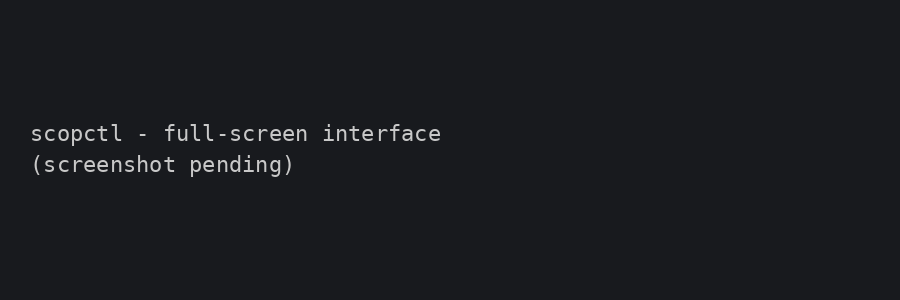

# scopctl — terminal client

**scopctl** controls and watches one or several running SCADAScop instances —
with a window or [headless](headless.md), on this computer or over the network —
from a terminal or a test script. It talks to SCADAScop's **web interface**, so
start that first (**Tools › Web Interface…**, or `--web <port>` headless).

```
SCADAScop --headless plant.ssw --start-all --web 8080
scopctl                       full-screen terminal interface (":" opens a command line)
scopctl status --rtus
```



It ships in the SCADAScop package (same folder as `SCADAScop.exe`) and needs a
terminal with VT support: Windows 10 or later (Windows Terminal, the classic
console or PowerShell), or any Linux terminal. Windows 7 is not supported.

## Connecting

By default scopctl connects to `http://127.0.0.1:8080/`. Give another address
with `-u`, which takes the link SCADAScop shows, a `host:port`, a host or just a
port, or set the environment:

```
scopctl -u http://10.0.0.5:8080/?token=4f1c status
scopctl -u 8090 status                      # 127.0.0.1:8090
scopctl -u lab-pc -t 4f1c status            # token given separately

set SCOPCTL_URL=http://10.0.0.5:8080/       # Windows
set SCOPCTL_TOKEN=4f1c
export SCOPCTL_URL=http://10.0.0.5:8080/    # Linux
```

A token is needed when the web interface was started with one (always when it
is open to the network). A monitoring-only interface answers `status`, `log`,
`wait` and `assert` but refuses every command (exit code 3).

## Three ways to use it

| | |
|---|---|
| `scopctl` | the **full-screen interface**: **F1** overview, **F2** channels, **F3** Status Messages, **:** a command line, **S** / **X** start / stop all, **?** help, **Esc** cancels a running `wait`, **q** or **F10** quits (SCADAScop keeps running) |
| `scopctl shell` | a **prompt** with history (↑ / ↓) and Tab completion of commands, instance, group, channel and RTU names — the same commands, one connection |
| `scopctl <command>` | a **one-shot**: does one thing, prints the result, exits with a code a script can test |

## Commands

| Command | |
|---|---|
| `status [--rtus] [--json]` | groups, channels and their state (`--rtus` adds RTUs and their scripts; `--json` the raw snapshot) |
| `start` / `stop all \| group <name> \| channel <name>` | start or stop channels |
| `sim`, `sim on [speed]`, `sim off`, `sim speed <0.1..10>` | the slave [simulation](simulation.md) |
| `script [status [<channel>[/<rtu>]]]` | the slave RTUs' scripts and their state |
| `script start \| stop \| reload <channel>/<rtu>` | control one RTU's [script](scripting.md) |
| `log [-f] [-n <lines>]` | Status Messages (`-f` follows until Ctrl+C) |
| `wait <condition> [--timeout <s>]` | wait until a condition holds (default 30 s) |
| `assert <condition>` | fail unless it holds now |
| `sleep <s>`, `echo <text>` | for scripts |
| `list instances \| groups \| channels \| rtus` | names, for scripts and completion |
| `run <file> [--keep-going] [--quiet] [--json]` | run a script of these commands (`-` = standard input) |
| `up [--timeout <s>]`, `down`, `shutdown` | start / end headless instances (see [Several instances](#several-instances-fleet)) |
| `help [conditions]`, `version` | |

Names with spaces go in quotes: `start channel "Feeder 1 RTU"`. A channel can be
given by a unique part of its name or as `group/channel`; an RTU by name or
address: `"Feeder 1 RTU/OS10"`, `"Feeder 1 RTU/10"`.

## Examples

### Look

```
C:\> scopctl status --rtus
SCADAScop 2.0 - Feeder demo - feeder-demo.ssw - GUI - up 1h 12m
Channels: 2 of 2 running (2 connected, 0 waiting, 0 error)   RTUs: 1 of 1 online
Simulation: off

[Feeder 1]
  CHANNEL                  PROTOCOL        STATE          ENDPOINT                         TX         RX   ERRORS TIMEOUTS
  Feeder 1 RTU             DNP3 Slave      connected      0.0.0.0:20000                  4312       2187        0        0
    - OS10                 ID 10           script running                               4312       2187        0        0
  SCADA                    DNP3 Master     connected      127.0.0.1:20000                2187       4312        0        0
    - OS10                 ID 10           online                                       2187       4312        0        0
```


```
scopctl log -n 20            the last 20 Status Messages
scopctl log -f               and keep printing them as they arrive
scopctl list channels        one name per line - pipe it into a loop
scopctl status --json        the same snapshot the web page uses, for jq / PowerShell
```

### Start, stop, simulate

```
scopctl start all
scopctl stop group "Feeder 1"
scopctl start channel "Feeder 1 RTU"
scopctl sim on 10            slave simulation at 10x real time
scopctl sim speed 2
scopctl sim off
```

`stop all` asks no confirmation — it is meant for scripts.

### Scripts on the RTUs

```
scopctl script status
Feeder 1 RTU/OS10 [10]: running (2 handlers, 2 timers)

scopctl script reload "Feeder 1 RTU/OS10"
scopctl script stop   "Feeder 1 RTU/OS10"
scopctl script start  "Feeder 1 RTU/OS10"
scopctl status --rtus                       the RTU line ends with "script running"
```

`script status` lists every slave RTU with a script — running or not, the bound
file if any, and how many handlers, timers and waiting coroutines it has.
`start` runs the saved source (or the bound file), `reload` re-reads the file
first, `stop` stops it. These are the same controls as the RTU's Script window
and the web page, so a test can swap a *normal* script for a *faulty RTU*
script by rebinding the file and reloading.

### Wait for a state, then check it

```
scopctl start all
scopctl wait all connected --timeout 20     exit 6 if not connected within 20 s
scopctl assert errors == 0                  exit 7 if the counter is not zero
scopctl wait "rtu Feeder 1 RTU/OS10 online"
scopctl wait "channels error > 0" --timeout 300    wait for something to go wrong
```

### From a shell script

Windows (`cmd`):

```bat
@echo off
scopctl start all || exit /b %errorlevel%
scopctl wait all connected --timeout 20 || (echo not connected & exit /b 6)
scopctl sim on 5
timeout /t 60 >nul
scopctl assert errors == 0
set RC=%errorlevel%
scopctl stop all
exit /b %RC%
```

PowerShell:

```powershell
scopctl start all
scopctl wait all connected --timeout 20
if ($LASTEXITCODE -ne 0) { throw "channels did not connect" }
$state = scopctl status --json | ConvertFrom-Json
$state.groups.channels | Format-Table name, state, errors
```

Linux / CI:

```bash
set -e
SCADAScop --headless plant.ssw --start-all --web 8080 &
scopctl wait all connected --timeout 30
scopctl assert timeouts == 0
scopctl shutdown                           # ends the headless instance
```

### The interactive shell

```
C:\> scopctl shell
scopctl> status
...
scopctl> start ch<Tab>          -> start channel
scopctl> start channel Fe<Tab>  -> start channel "Feeder 1 RTU"
scopctl> wait channel "Feeder 1 RTU" connected
scopctl> script status
scopctl> exit
```

History is kept in `~/.scopctl_history`.

## Conditions

For `wait` and `assert`:

- `channel <name> connected|waiting|error|stopped|running`
- `group <name> connected|running|stopped`, `all connected|running|stopped`
- `rtu <channel>/<rtu> online|offline`, `sim on|off`
- `channels running|connected|waiting|error|stopped <op> <n>`,
  `rtus online|offline <op> <n>`, `errors|timeouts <op> <n>` with `<op>` one of
  `== != < <= > >=`

`all` and `group` mean *every channel of them*; the counters are summed over
the instances a command addresses. `wait` polls twice a second.

## Test scripts

A `.scop` file holds one command per line, `#` for comments, quotes around
names with spaces, and `source <file>` to include another (8 levels deep).
There are no variables or loops — the shell around `scopctl run` has them. The
run stops at the first failure (`--keep-going` runs on) and its exit code is the
first failure's; `--quiet` prints only failures, `--json` one JSON object per
command.

```
# smoke.scop - start everything, let it run, check nothing failed
start all
wait all connected --timeout 20
assert errors == 0
sim on 5
sleep 60
assert rtus offline == 0
assert timeouts == 0
stop all
```

```
# faulty-rtu.scop - swap the outstation's behaviour and watch the master cope
echo switching OS10 to the faulty script
script stop "Feeder 1 RTU/OS10"
script start "Feeder 1 RTU/OS10"       # the Script window has the faulty file bound
wait "channels error > 0" --timeout 120
echo master reported the fault
source restore.scop
```

```
scopctl run smoke.scop
scopctl run faulty-rtu.scop --keep-going --json > result.json
echo status | scopctl run -                 commands from standard input
```

**Exit codes**: 0 done, 1 bad command line, 2 cannot reach SCADAScop, 3 token
refused or monitoring-only, 4 no such group / channel / instance, 5 unexpected
answer, 6 `wait` timed out, 7 `assert` failed. With several instances the worst
code wins (2 before 3 before 4 …).

## Several instances (fleet)

A plant split across several SCADAScop instances — one per VM, or one per
substation — is driven from one scopctl. Repeat `-u`, set
`SCOPCTL_URL="a;b"`, or list the instances in a **fleet file** and pass
`-F plant.fleet`:

```
# plant.fleet
exe = C:\Scop\SCADAScop.exe
north = 8080 run north.ssw start-all log north.log
south = 8081 run south.ssw
far   = http://10.0.0.5:8080/?token=abcd        # attach only
```

- `name = address` attaches to a running instance. An instance named only by
  its address takes the name SCADAScop reports (`--name`, or the workspace's
  **File › Instance Name**).
- `name = port run <workspace> [start-all] [sim] [log <file>]` is an instance
  scopctl can **launch** on this computer: `scopctl -F plant.fleet up` starts
  every such instance that does not answer yet, headless, and waits until it
  does; `down` ends them through the web API. `exe =` says where SCADAScop is
  (else `SCADASCOP_EXE`, else beside scopctl, else the PATH).
- `shutdown` ends any *headless* instance addressed; a SCADAScop with a window
  refuses and is reported, never killed.

```
scopctl -F plant.fleet up
scopctl -F plant.fleet status                 one block per instance
scopctl -F plant.fleet @north stop all        only north
scopctl -F plant.fleet start channel south:RTU-7
scopctl -F plant.fleet wait all connected
scopctl -F plant.fleet                        the TUI with an Instances table instead of the tiles
scopctl -F plant.fleet down
```

`@name` (or `@all`) before a command addresses some instances; without it a
command — `stop all` included — goes to every instance. A group or channel name
may carry its instance: `start channel south:RTU-7`, `stop group "north:Feeders"`.

!!! warning "Tokens travel in clear"
    The web interface is plain HTTP. Keep fleet files, which hold tokens, out of
    version control and prefer the loopback address.
