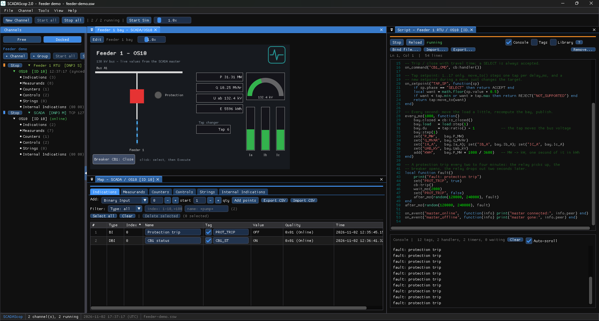

# Script examples

Worked examples for [RTU scripting](scripting.md). The first one is a complete
feeder bay and is the script that ships in `docs/sample-workspaces/feeder-demo.ssw`
(also as `docs/sample-workspaces/feeder_bay.lua`); the rest are short recipes
you can paste into a script one at a time.

Every example assumes the points it names carry those **tags** (Points window ›
Tag column — see [Tags](scripting.md#1-tags-how-a-script-addresses-points)).

## A complete feeder bay

The demo workspace has one DNP3 outstation, *OS10*, with these tagged points:

| Tag | Point | Role |
|---|---|---|
| `CB1_CMD` | binary output 0 | breaker control (CROB) |
| `CB1_ST` | double-bit input 0 | breaker status |
| `PROT_TRIP` | binary input 0 | protection relay picked up |
| `P_MW`, `Q_MVAR`, `IA_A`, `IB_A`, `IC_A`, `UAB_KV` | analog inputs 0–5 | measurands |
| `TAP_POS` | analog input 6 | tap position |
| `TAP_SP` | analog output 0 | tap setpoint |
| `KWH` | counter 0 | energy accumulator |

and this script:

```lua
-- Feeder bay (DNP3 slave): breaker, bay model, tap changer, energy, faults.
local cb   = Breaker.new{ status = "CB1_ST", travel_ms = 120 }
local bay  = Bay.new{ Un_kV = 138, Pmax_MW = 50, pf = 0.95, load = 0.6,
                      unbalance = 0.02, noise = 0.005 }
local tap  = TapChanger.new{ min = 1, max = 17, pos = 9, delay_ms = 1500,
                             position = "TAP_POS" }
local load = Signal.walk{ min = 0.3, max = 0.9, delta = 0.01, value = 0.6 }

-- Trip / close with travel time; a SELECT is always accepted.
on_command("CB1_CMD", cb:handler())

-- Tap setpoint: 1..17 only. move_to() steps one tap per delay_ms, and a
-- new setpoint during a move just changes the target.
on_setpoint("TAP_SP", function(sp)
    if sp.phase == "SELECT" then return ACCEPT end
    local want = math.floor(sp.value + 0.5)
    if want < tap.min or want > tap.max then return REJECT("NOT_SUPPORTED") end
    return tap:move_to(want)
end)

-- Every second: move the load a little, recompute the bay, publish.
every_ms(1000, function()
    bay.closed = cb:is_closed()
    bay.load   = load:step(1)
    bay.du     = tap:ratio() - 1            -- the tap moves the bus voltage
    bay:step(1)
    set("P_MW",   bay.P_MW)
    set("Q_MVAR", bay.Q_MVAr)
    set("IA_A",   bay.Ia_A); set("IB_A", bay.Ib_A); set("IC_A", bay.Ic_A)
    set("UAB_KV", bay.Uab_kV)
    add("KWH",    bay.P_MW * 1000 / 3600)   -- MW -> kW, one second of it in kWh
end)

-- A protection trip every two to four minutes: the relay picks up, the
-- breaker opens, the relay drops out two seconds later.
local function fault()
    print("fault: protection trip")
    set("PROT_TRIP", true)
    cb:trip()
    wait_ms(2000)
    set("PROT_TRIP", false)
    after_ms(random(120000, 240000), fault)
end
after_ms(random(120000, 240000), fault)

on_event("master_online",  function(info) print("master connected:", info.peer) end)
on_event("master_offline", function(info) print("master gone:", info.peer) end)
```

What to watch, with the master connected:

1. The master's map shows `P_MW`, the currents and the voltage moving every
   second, `KWH` counting up; the Communication Monitor shows the unsolicited
   responses the `set()` calls produce.
2. Send a **trip** from the master (or click the breaker on the demo display):
   `CB1_ST` goes *intermediate* for 120 ms, then *open*; a second later the
   powers and currents are zero while the voltage stays.
3. Write **12** to the tap setpoint: `TAP_POS` steps 9 → 10 → 11 → 12, one step
   every 1.5 s, and `UAB_KV` rises with each step. Write **25**: the analog
   output status comes back `NOT_SUPPORTED`.
4. Wait a few minutes: `PROT_TRIP` goes on, the breaker trips, the relay drops
   out — and stays open until the master closes it again.

The whole sequence is visible on the display of the demo workspace, which is
also the subject of the [HMI displays](displays.md) walkthrough.



## Recipes

### Refuse commands while the device is in local mode

```lua
on_command("CB1_CMD", function(cmd)
    if get("LOCAL_MODE") then return REJECT("LOCAL") end
    return cb:handler()(cmd)
end)
```

A DNP3 master sees status code *LOCAL* (6); an IEC master a negative ACTCON;
a Modbus master exception 04. Flip `LOCAL_MODE` from the Points window or a
display to switch the behaviour while the test runs.

### Test the master's command timeout

```lua
-- Answer every control 4 s late: a master with a 3 s timeout must report it.
on_command("CB1_CMD", function(cmd) return ACCEPT, 4000 end)

-- Or never answer the operate at all, only the select.
on_command("CB2_CMD", function(cmd)
    if cmd.phase == "SELECT" then return ACCEPT end
    return ACCEPT, 60000
end)
```

The second return value delays the protocol answer only; the handler itself
has run and the point has moved, so you also see what happens when the
master retries a command that the RTU already executed.

### Honour a DNP3 pulse command

```lua
-- A pulse output: on for cmd.on_ms (default 500 ms), repeated cmd.count times.
on_command("RECLOSE_CMD", function(cmd)
    if cmd.phase == "SELECT" then return ACCEPT end
    if cmd.op ~= "PULSE_ON" then return REJECT("NOT_SUPPORTED") end
    local n, on, off = math.max(cmd.count or 1, 1), cmd.on_ms or 500, cmd.off_ms or 500
    for i = 1, n do
        set("RECLOSE_ST", true); wait_ms(on)
        set("RECLOSE_ST", false); if i < n then wait_ms(off) end
    end
end)
```

### IEC double command and regulating step

```lua
-- C_DC on a disconnector: ON closes, OFF opens, through a Breaker object
local ds = Breaker.new{ status = "DS1_ST", travel_ms = 3000 }
on_command("DS1_CMD", ds:handler())

-- C_RC on a transformer: HIGHER / LOWER
on_command("TAP_RL", function(cmd)
    if cmd.phase == "SELECT" then return ACCEPT end
    if cmd.state == "HIGHER" then return tap:raise() end
    if cmd.state == "LOWER"  then return tap:lower() end
    return REJECT("NOT_SUPPORTED")
end)
```

`cmd.op` carries the QU qualifier as `LATCH_ON` / `PULSE_ON` … when you need
to distinguish a persistent from a short-pulse command; `cmd.phase` is
`SELECT` or `EXECUTE`.

### Setpoint with slew rate

```lua
local target, filt = 0, Signal.lag{ tau_s = 5 }
on_setpoint("P_SET", function(sp)
    if sp.value < 0 or sp.value > 50 then return REJECT("NOT_SUPPORTED") end
    target = sp.value
end)
every_ms(500, function() set("P_MW", filt:step(0.5, target)) end)
```

The feedback point follows the setpoint with a 5 s time constant instead of
jumping — the way a governor or a battery inverter answers.

### Counters and freezes

```lua
-- Count pulses: one per second while the pump runs
every_ms(1000, function() if get("PUMP_RUN") then add("PULSES", 1) end end)

-- DNP3: note a freeze request in the console
on_event("counter_freeze", function(info)
    print("counters frozen by master", info.master, "interval", info.interval_ms)
end)
```

`add()` wraps at the point's rollover, so a 16-bit counter rolls over as the
real one would.

### Quality flags

```lua
-- Mark a transducer as failed for ten seconds every two minutes
every_ms(120000, function()
    quality("P_MW", 0x00)          -- DNP3: ONLINE bit cleared
    wait_ms(10000)
    quality("P_MW", 0x01)
end)
```

The flag byte is the protocol's: DNP3 `0x01` online, IEC the IV / NT / SB / BL /
OV bits; `quality(tag)` reads it back. Modbus has no quality.

### Modbus: a status word and a packed command register

```lua
-- Tags: STATUS (holding register, bits), CMD (holding register written by the master),
--       PUMP_RUN (coil)
on_setpoint("CMD", function(sp)                     -- FC06 / FC16 on the CMD register
    local w = math.tointeger(sp.value)
    if bit(w, 0) then set("PUMP_RUN", true)  end    -- bit 0 = start
    if bit(w, 1) then set("PUMP_RUN", false) end    -- bit 1 = stop
    if bits(w, 8, 15) ~= 0 then return REJECT("ILLEGAL_VALUE") end
end)

every_ms(1000, function()
    local w = 0
    w = with_bit(w, 0, get("PUMP_RUN"))
    w = with_bit(w, 5, get("PROT_TRIP"))
    set("STATUS", w)
end)
```

In Modbus the setpoint handler runs *before* the register is stored:
`sp.value` is the new value, `get("CMD")` still the old one; `REJECT` returns
an exception and nothing is written. Writes that cover several registers
(FC16) call the handler once per tagged register and are dropped whole when
one of them refuses.

### A daily load curve at 10× speed

```lua
local day = LoadProfile.hourly{ [0] = 0.4, [6] = 0.5, [9] = 0.85, [13] = 0.75,
                                [18] = 1.0, [22] = 0.6 }
every_ms(1000, function()
    bay.load = day:at(now_ms()); bay:step(1)
    set("P_MW", bay.P_MW)
end)
```

Switch the slave simulation on at 10× (the toolbar, the web page or
`scopctl sim on 10`): `now_ms()` follows the simulated clock, so a day passes
in 2.4 h. Put `P_MW` on a chart to see the curve.

### Log to Status Messages

```lua
on_change("CB1_ST", function(v, old)
    log("warn", string.format("CB1 %s -> %s", tostring(old), tostring(v)))
end)
```

`print()` goes to the Script console only; `log(level, text)` (`"info"`,
`"warn"`, `"error"`) also writes a Status Messages line prefixed `Script:`, so
it appears in the merged log, the web page and `scopctl log -f`.

### Several small scripts in one RTU

A script is one Lua file per RTU, but it does not have to be one long one:
write each behaviour as a function that registers its own handlers, then call
the ones you want at the end.

```lua
local function breaker_part()  ...  end
local function bay_part()      ...  end
local function fault_part()    ...  end

breaker_part(); bay_part()
-- fault_part()         -- commented out for the acceptance test
```

Bind the file (**Bind file…**) and edit it in your own editor: the RTU reloads
it on every save.

## Running the examples from scopctl

Scripts are started, stopped and reloaded from the terminal as well, which is
how a test run can swap behaviours:

```
scopctl script status
scopctl script reload "Feeder 1 RTU/OS10"
scopctl script stop "Feeder 1 RTU/OS10"
```

See [scopctl](scopctl.md#scripts-on-the-rtus).
