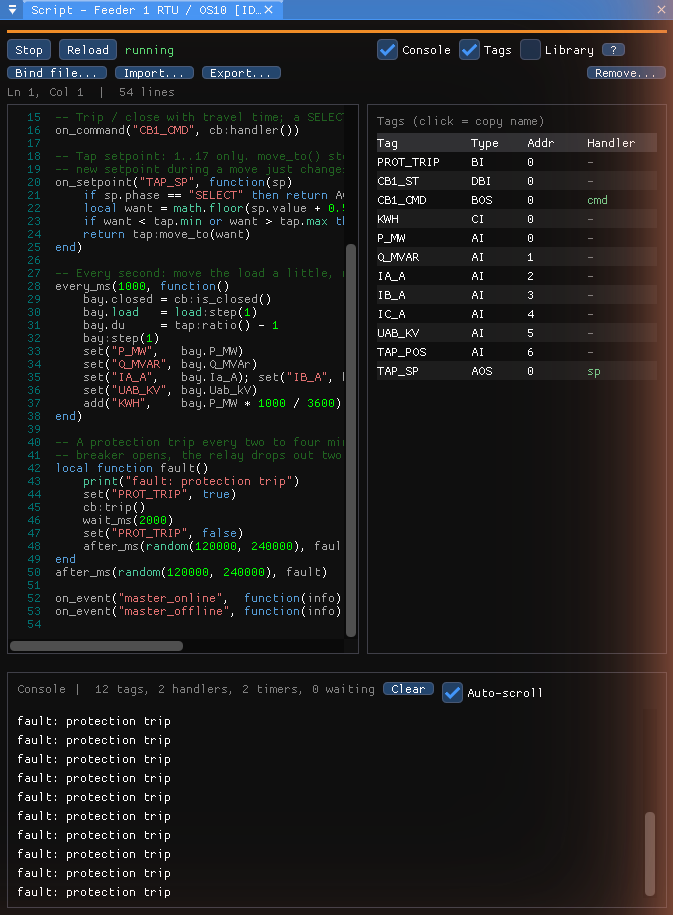
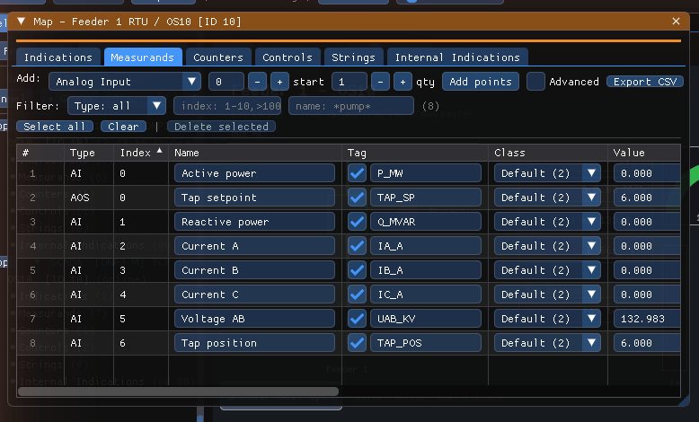
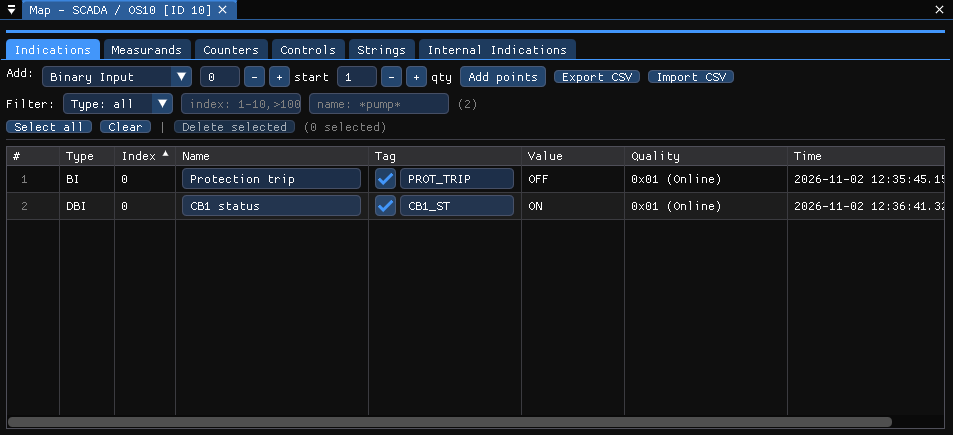
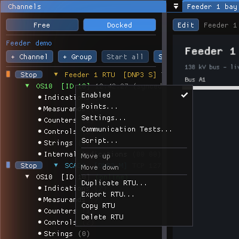
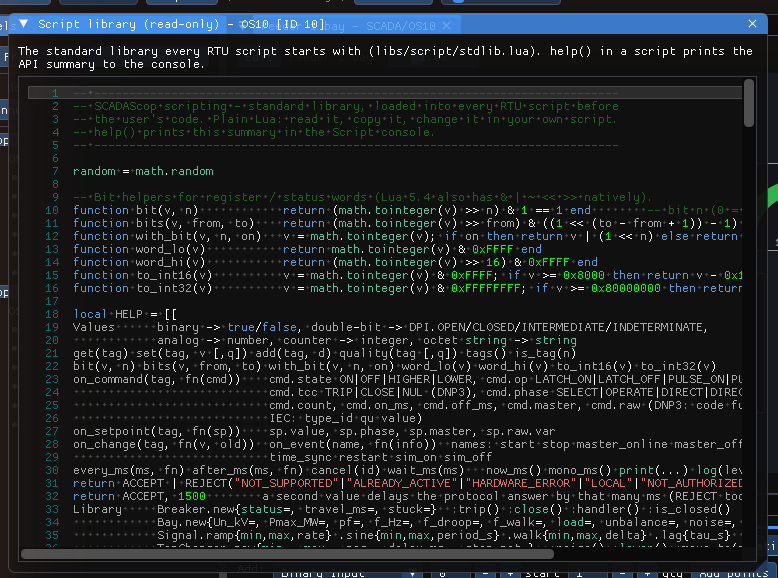

# RTU scripting

!!! info "SCADAScop 2.0"
    Scripting is a SCADAScop feature: it is not available in the standalone tools.

A **slave RTU** — DNP3 outstation, IEC 104 / IEC 101 station or Modbus device —
can run a **Lua script** that makes it behave like a real device in the field:
accept or refuse commands with the protocol's own answer, answer late, move a
breaker through its travel time, step a tap changer, compute a bay's currents
and powers, update counters, trip on a fault. Without a script the RTU behaves
exactly as before; a script can be added to an existing configuration point by
point.



Each RTU has its own script and its own Lua 5.4 state. A script cannot touch
files or the network (no `io`, `os`, `require` or `load`), and a runaway handler
is stopped without stopping the script or the protocol.

The chapter is in three pages:

- this one — **tags**, the Script window and how handlers work;
- [Script library](scripting-library.md) — the objects that ship with every
  script (`Breaker`, `Bay`, `TapChanger`, `Signal`, `LoadProfile`) explained
  with examples;
- [Script examples](scripting-examples.md) — a complete feeder bay, then a
  cookbook of short recipes (interlocks, late answers, pulses, counters, Modbus
  words…).

The function-by-function reference is the [Script API](../reference/script-api.md).

!!! tip "Try it first"
    `docs/sample-workspaces/feeder-demo.ssw` is a ready-made workspace: a DNP3
    outstation *OS10* with tagged points and the feeder-bay script already
    running, the SCADA master polling it, and an HMI display over the master's
    points. Open it, press **Start all**, and the rest of this chapter can be
    followed on screen.

## 1. Tags — how a script addresses points

A script never sees groups, indexes, object addresses or register numbers. It
sees **tags**: short names you give to the points the script is allowed to
read, write or decide about.

```
on_command("CB1_CMD", ...)   -- not "binary output 0", not "IOA 2001", not "coil 17"
set("P_MW", bay.P_MW)
```

**Why tags instead of addresses**

- The same script runs unchanged on a DNP3 outstation, an IEC 104 station or a
  Modbus device — only the tag column differs.
- A point can be re-indexed (or the Modbus map rearranged) without touching the
  script.
- Tags are **opt-in**: you tag the handful of points the script needs, not the
  whole database. A 2 000-point RTU with a five-tag script stays a 2 000-point
  RTU.
- The same tags are what [HMI displays](displays.md) bind to and what the
  [Watch window](watch.md) shows beside the point name, so one naming serves
  everything.

### Giving a point a tag

Open the RTU's points (right-click the RTU › **Points…**) and use the **Tag**
column: tick the box and type a name.



| Rule | |
|---|---|
| Characters | letters, digits and `_`; not starting with a digit; not a Lua keyword (`end`, `and`, `function`…) |
| Uniqueness | unique **inside the RTU** — two RTUs may both have `CB1_ST` |
| Case | case-sensitive: `P_MW` and `p_mw` are different tags |
| Style | the examples use `UPPER_CASE` for tags and `lower_case` for Lua variables, so it is obvious in a script which is which |

A red tag field is an invalid or duplicated name; the script refuses to start
until it is fixed, and names the point in the console.

**Per protocol**

- **DNP3 / IEC 104 / IEC 101** — every tab of the Points window has the column
  (binary and double-bit inputs, analogs, counters, binary and analog outputs,
  strings).
- **Modbus** — show the column with the **Tag column** checkbox next to
  **Display options**. In a block map every cell can be tagged; in a PLC-style
  device switch to the **Bits** view to tag a single bit of a word. A tag cannot
  point *inside* a 32 / 64-bit value — tag its first register, and the script
  gets the whole decoded value.

### What a tagged point looks like to the script

The value a script reads with `get(tag)` and writes with `set(tag, value)` is the
**engineering value** the point shows on screen — scaled analogs are scaled,
Modbus registers are decoded through the cell's display format (int16, float,
bit field…), binaries are `true` / `false`, double-bits are `DPI.OPEN`,
`DPI.CLOSED`, `DPI.INTERMEDIATE`, `DPI.INDETERMINATE`, counters are integers.
Writing goes through the protocol's normal update path, so a `set()` that
changes a point produces an event / unsolicited response / spontaneous ASDU
exactly as a change from the simulation would.

### Tags on the master side

Master points (DNP3 / IEC map rows, Modbus poll cells) have a Tag column too, in
the same place. A master's tags are not for scripts — masters do not run
scripts — but for displays and the Watch window: a display can then show the
value the SCADA master *received* next to the value the simulated RTU *serves*.
The full name of any tag is `Channel/RTU/tag`, for example `SCADA/OS10/P_MW`.



## 2. The Script window

Right-click the RTU › **Script…**.



The window has:

- a toolbar — **Run** / **Stop**, **Reload** (re-runs the script with the
  editor's changes), the state (*stopped*, *running*, *error*), the **Console**,
  **Tags** and **Library** toggles and **?** for a short API summary;
- the **editor** — Lua colouring, line numbers, the last error marked on its
  line (click the error in the console bar to jump to it), a line / column
  readout;
- the **console** — `print()` and `log()` output, errors (they also go to Status
  Messages, prefixed `Script:`), and a status line with the number of tags,
  handlers, timers and waiting coroutines;
- the RTU's **tags**, each with its type, address and the handlers that use it
  (*cmd*, *sp*, *chg*); click one to copy its name into the clipboard.

**Where the source lives**

- By default the script is stored **in the workspace**, in a `[Script]` block
  under the RTU (see [Workspace keys](../reference/workspace-keys.md#tags-and-scripts)),
  and starts with the workspace when it was running when the workspace was
  saved.
- **Bind file…** keeps the source in a `.lua` file instead: the editor turns
  read-only and the script reloads whenever the file changes, so you can edit
  it in your own editor. Put the file beside the workspace or in a `scripts`
  folder next to it and the workspace stays portable; the workspace also keeps
  a copy, which runs when the file is missing (see
  [Files the workspace uses](workspaces.md#files-the-workspace-uses-scadascop)).
  **Unbind** goes back to the inline copy.
- **Import…** / **Export…** copy a `.lua` file in or out without binding it.
- **Remove…** deletes the script from the RTU.

The **Library** toggle opens the standard library's source, read-only — every
object of the [Script library](scripting-library.md) is plain Lua you can read,
copy into your own script and change.



## 3. Write handlers

A script is a Lua file that **registers handlers** and **timers**, then
returns. Everything after that happens when the protocol calls a handler.

```lua
-- A breaker with 120 ms travel, its status on a double-bit point
local cb = Breaker.new{ status = "CB1_ST", travel_ms = 120 }
on_command("CB1_CMD", cb:handler())

-- A setpoint that refuses values out of range
on_setpoint("P_SET", function(sp)
    if sp.value < 0 or sp.value > 50 then return REJECT("NOT_SUPPORTED") end
    set("P_MW", sp.value)
end)

-- Every second: publish a measurand
every_ms(1000, function()
    set("F_HZ", 60 + random() * 0.02 - 0.01)
end)
```

**Decisions.** A command or setpoint handler returns `ACCEPT` (also when it
returns nothing) or `REJECT(code)`. The code becomes the protocol's refusal:

| Protocol | `REJECT` becomes |
|---|---|
| DNP3 | the CROB / analog output status code (`NOT_SUPPORTED`, `HARDWARE_ERROR`, `LOCAL`, `ALREADY_ACTIVE`, `NOT_AUTHORIZED`, `TIMEOUT`, `FORMAT_ERROR`) |
| IEC 104 / 101 | a negative ACTCON (the code goes to the trace) |
| Modbus | an exception: `ILLEGAL_VALUE` → 03, `HARDWARE_ERROR` → 04, `BUSY` → 06, or a number |

**Late answers.** A second return value delays the protocol answer in
milliseconds — a slow RTU, or a test of the master's timeout:

```lua
on_command("CB1_CMD", function(cmd) return ACCEPT, 1500 end)
on_command("CB2_CMD", function(cmd) return REJECT("HARDWARE_ERROR"), 300 end)
```

**Waiting.** Handlers and timers run as coroutines: `wait_ms(ms)` suspends one
and resumes it later, so a handler can model a sequence (intermediate position,
travel time, end position). A handler that waits has accepted the command; the
rest of it runs on later ticks while the protocol goes on answering.

**Selections.** A select-before-operate command calls the handler twice — once
with `cmd.phase == "SELECT"` (refuse it to deny the selection) and once for the
operate / execute. A handler that does not look at `cmd.phase` simply runs
twice, which is usually harmless for a decision and wrong for an action — check
the phase before moving anything.

**After `ACCEPT`** the tool's built-in behaviour still runs (output status
feedback, the point's links), so a handler only has to add what is special.
`REJECT` runs nothing.

## 4. React to changes and events

```lua
on_change("CB1_ST", function(value, old) print("breaker", old, "->", value) end)
on_event("master_online",  function(info) print("master connected:", info.peer) end)
on_event("sim_on",         function(info) print("simulation started at", info.speed, "x") end)
```

`on_change` fires for any writer — the master, the simulation, the Points
window, a display, another handler, and the script's own writes (guard against
loops: a change handler that writes the same tag calls itself).

| Event | Fired | `info` fields |
|---|---|---|
| `start`, `stop` | when the script starts / stops | — |
| `master_online`, `master_offline` | a master connects / disconnects (TCP), or the link comes up / goes down | `peer` |
| `sim_on`, `sim_off` | the slave simulation is switched on / off | `speed` |
| `time_sync` | the master wrote the time (DNP3 group 50 / IEC C_CS) | DNP3: `utc_ms`, `lan`, `master`; IEC: `utc_ms`, `applied` |
| `restart` | DNP3 cold / warm restart; IEC reset process (C_RP) | DNP3: `cold`, `master`; IEC: `qrp`, `dropped` |
| `counter_freeze` | DNP3 freeze request on the counters | `due_ms`, `interval_ms`, `master` |

Modbus devices see `start`, `stop`, `master_online` / `master_offline` and the
simulation events only.

## 5. Use the standard library

The library turns the handlers above into one-liners for the usual pieces of a
substation:

| Object | What it models |
|---|---|
| `Breaker.new{ status, travel_ms, stuck }` | open / close with an intermediate state for the travel time; `:handler()` is a ready-made `on_command` handler |
| `Bay.new{ Un_kV, Pmax_MW, pf, f_Hz, load, … }` | a feeder bay: `:step(dt)` then read `P_MW`, `Q_MVAr`, phase currents and voltages, `f_Hz`, `E_kWh` |
| `TapChanger.new{ min, max, pos, delay_ms, position }` | `:raise()`, `:lower()`, `:move_to(n)` one step per `delay_ms`, `:ratio()` |
| `Signal.ramp` / `.sine` / `.walk` / `.lag` | value generators: `:step(dt)` returns the next value |
| `LoadProfile.hourly{ [0]=…, … [23]=… }` | a daily load curve: `:at(now_ms())` |

Each one is explained, with its settings and an example, in
[Script library](scripting-library.md).

## Running and controlling scripts

- Scripts tick with the channel (every 20 ms), not with the screen refresh,
  and keep running [headless](headless.md).
- A runtime error is reported and the handler stays registered (the next event
  tries again); a script that exceeds the instruction limit (10 million
  instructions in one handler run), or does not load, is stopped.
- The [web interface](headless.md) shows each RTU's script state and starts,
  stops or reloads it; so does [scopctl](scopctl.md#scripts-on-the-rtus):
  `scopctl script status`, `scopctl script reload "Feeder 1 RTU/OS10"`.
- Duplicating, exporting or copying an RTU carries its tags and its script.

## Protocol details in `cmd` and `sp`

| | DNP3 | IEC 104 / 101 | Modbus |
|---|---|---|---|
| command | CROB (group 12) | C_SC, C_DC, C_RC | FC05 / FC15 on a tagged coil (or a command map) |
| `cmd.state` | — (`cmd.tcc` = `TRIP` / `CLOSE`, `cmd.op` = `LATCH_ON` …) | `ON` / `OFF`, `HIGHER` / `LOWER` | `ON` / `OFF` |
| `cmd.phase` | `SELECT`, `OPERATE`, `DIRECT`, `DIRECT_NOACK` | `SELECT`, `EXECUTE` | — |
| setpoint | analog output (group 41) | C_SE_NA / NB / NC, C_BO | FC06 / 16 / 22 / 23 on a tagged register, decoded with the cell's display format |
| `REJECT` | status code | negative ACTCON | exception, the whole multi-write dropped |

In Modbus the handler runs before the value is stored (`get()` still returns the
old value; `sp.value` is the new one). Modbus has no quality flags.
