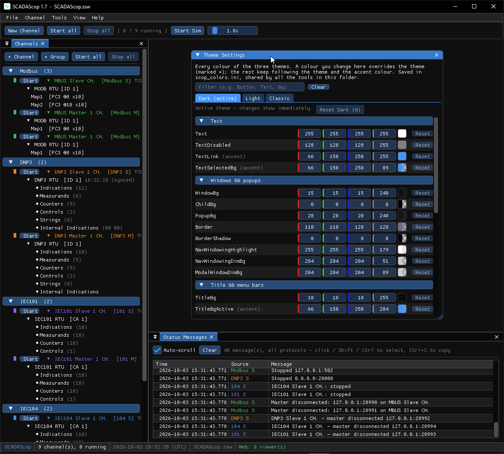

# Themes

Every tool has **Dark**, **Light**, **Classic** and **Soft Dark** themes, an
accent colour, and a full per-colour override editor. The choice is saved and
shared by every tool started from the same folder.

## Switching

**View → Theme** picks Dark / Light / Classic / Soft Dark and the accent colour.
The change applies immediately.

- **Dark** — the stock near-black palette, the accent at full strength.
- **Light** — a toned-down light palette with black text.
- **Classic** — the grey-blue classic palette.
- **Soft Dark** — neutral mid-dark greys, a slightly lighter menu bar, darker
  title bar and input fields, grey buttons that take the accent only when
  hovered or pressed, neutral docked tabs, and the accent toned down towards
  the window grey: with the default **Blue** accent the result is a steel-blue
  look; any other accent is muted the same way.

## Theme Settings

**View → Theme → Settings…** opens an editor listing every colour of the four
themes — text, backgrounds, borders, title and menu bars, frames, buttons,
headers, tabs, tables, plots and more — grouped and filterable, with one tab per
theme.

- Change a colour to **override** the theme (marked `*`), with a per-colour and a
  per-theme **Reset**.
- Colours you leave alone keep following the theme and the accent.

Overrides are saved in `scop_colors.ini` next to the tools' other settings and
are shared by every tool started from that folder.
