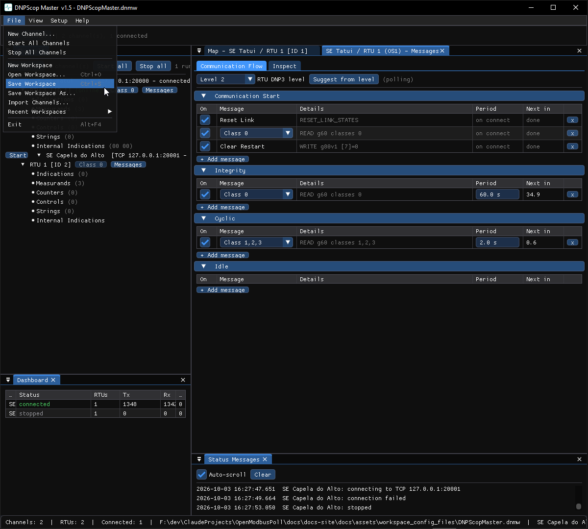

# Workspaces

Everything you configure in a tool — channels, stations, points, schedules,
simulation, glue logic — is saved in a single **workspace** file, so a whole
test setup reopens exactly as you left it, or moves to another machine.



## Save and load

- **File → Save Workspace** / **Save Workspace As…**
- **File → Open Workspace**
- **File → New Workspace** starts fresh.

Each tool uses its own extension (for example `.dnsw`-style per tool); SCADAScop
writes one self-contained `.ssw` that carries every embedded tool's channels.

## Format 2 (plain text)

Workspaces use a plain-text, human-readable grammar (see
[Workspace keys](../reference/workspace-keys.md)):

```
[Workspace] Format=2
[Channel] Tool=DNP3  Name=...  Running=1  <endpoint / link / TLS keys>
  [Rtu] Proto=DNP3  Addr=10  Name=...  <station keys>
    [Points] ...
```

Containment is by order, unknown keys are ignored, and a block only needs the
keys that differ from the defaults — so a headless configuration can be written
by hand. Masters save `Running=` too, so a master workspace restarts its
channels on load.

!!! warning "Older workspaces are not read"
    The tools only read format 2. A workspace written by an older version is
    rejected with a message; there is no automatic converter.

## Files the workspace uses (SCADAScop)

A SCADAScop workspace can refer to other files: an RTU script bound to a `.lua`
file, a display imported from a `.ssd` file, and the PNG / SVG pictures of
display Image objects. To keep a workspace working when it is copied to another
folder or another computer:

- **Keep the files with the workspace.** A file in the workspace's own folder,
  or in a `scripts`, `displays` or `images` sub-folder next to it, is saved
  *relative* to the workspace (`bay.lua`, `scripts/bay.lua`,
  `images/sld.svg`) — copy the folder and everything still connects. A file
  anywhere else keeps its full path.
- **Moved files are found by name.** When a file is not where the workspace
  says, SCADAScop looks for a file of the same name in the workspace folder and
  its `scripts`, `displays` and `images` sub-folders, and uses it.
- **Scripts travel inside the workspace too.** A script bound to a file is also
  saved in the workspace as a copy; when the file is missing the RTU runs that
  copy (the Script window shows the file in orange).
- **File › Missing Files…** lists what is still missing (it opens by itself after
  loading a workspace with missing files). **Locate…** one file: every other
  missing file that lived in the same folder and exists in the new one is
  re-pointed too. **Show every file the workspace uses** lists them all, with
  how each is stored.

### Packages: everything in one zip

**File › Save Package…** writes one `.zip` with the workspace and every file it
uses, sorted into folders:

```
plant.zip
  plant.ssw        the workspace, pointing at the folders below
  scripts/         the RTU script files
  displays/        the display .ssd files
  images/          the display pictures
```

Two different files with the same name are kept apart (`bay.lua`,
`bay_2.lua`); a missing file is left out and named in Status Messages. Send the
zip — **File › Open Workspace** opens it directly (also `--headless plant.zip`):
it is extracted into a folder beside it (`plant`, or `plant (2)` when that
exists) and the workspace opens from there, every link in place.

Save As to another folder re-writes the relative paths for the new place. A
channel export (`.ssc`) stores its script files relative to the `.ssc`, and a
display export (`.ssd`) its pictures relative to the `.ssd`, with the same rule.

## Moving pieces between tools

You do not have to save and reload whole workspaces to move configuration:

- **Export / Import channel** and **Export / Import RTU** write `.ssc` / `.ssr`
  files.
- **Copy / Paste RTU** uses the clipboard as plain text, so it works between two
  running tools, and even to and from a text editor.

See [Fan-out and duplicate](fanout.md) for creating many channels or RTUs at
once.
